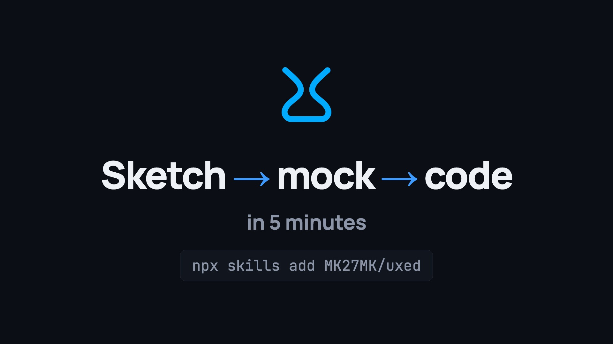

# uxed

[](assets/walkthrough.mp4)

## Install

With [skills](https://github.com/vercel-labs/skills), for any agent:

```
npx skills add MK27MK/uxed
```

### Claude Code

```
/plugin marketplace add MK27MK/uxed
/plugin install uxed@uxed
```

### Codex

```
codex plugin marketplace add MK27MK/uxed
codex plugin add uxed@uxed
```

## Skills

- [building-ui](skills/building-ui/README.md)

## Examples

- [Strategy search](examples/mock-palette/README.md): a component mocked from three sketches and a spec with building-ui's mock mode.
