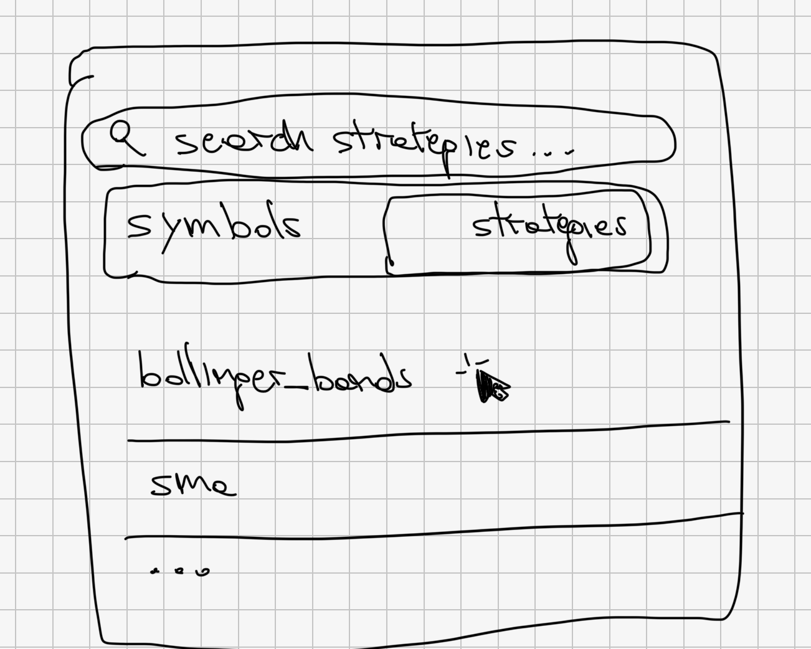
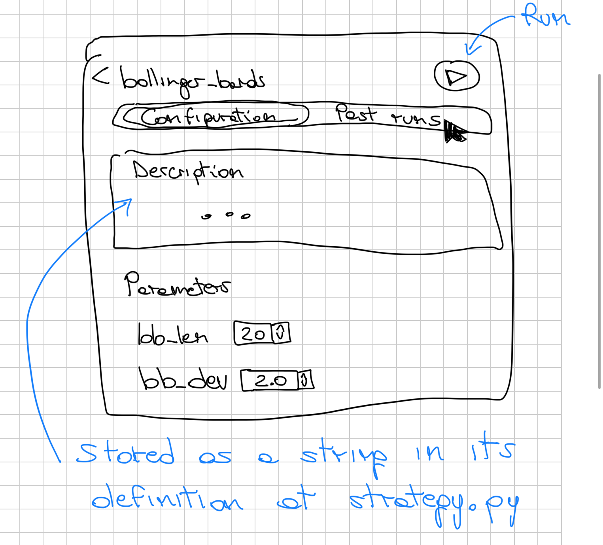
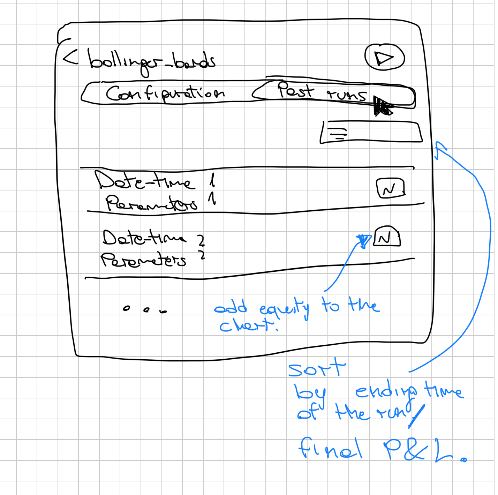
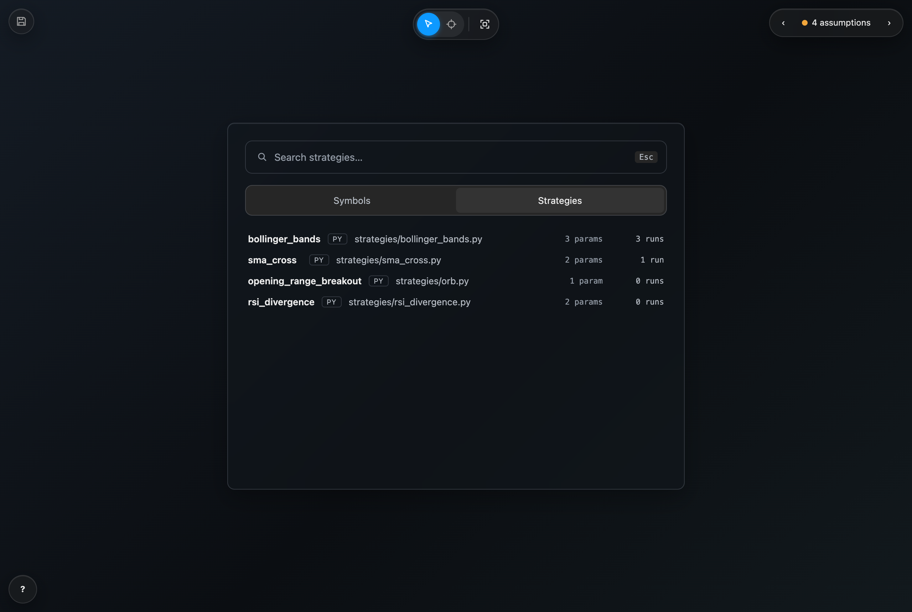
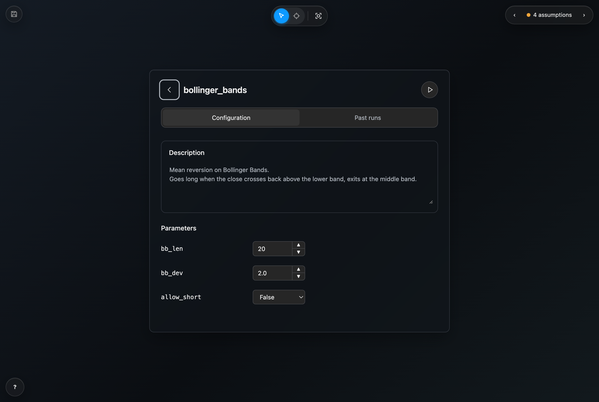
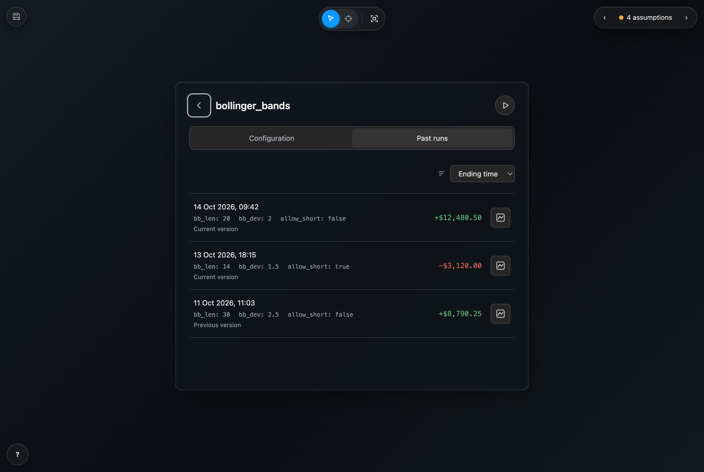

# Strategy search

A real task from Komplex, a trading app: give the symbol search dialog a Strategies tab where you open a strategy, change its parameters, run a backtest and see its past runs.

## Input

The spec, as written in the issue:

> Move strategies to their own tab in the symbol search, as in the sketches. A strategy list, discovered in the `strategies/` subfolder of the configured folder. Once a strategy is open, it must be possible to change its parameters, run a backtest and see past runs.

And three sketches:

| Search | Configuration | Past runs |
| --- | --- | --- |
|  |  |  |

## Output

[`mock.html`](mock.html), in the app's own style, opened in the shell:

| Search | Configuration | Past runs |
| --- | --- | --- |
|  |  |  |

And [`mock.notes.json`](mock.notes.json): 51 behaviour rules on 18 elements, 4 of them assumptions for the user to confirm.

## Notes

- The sketches only give layout. Colours, radii, fonts and spacing come from the app's tokens and from the existing symbol search.
- Every state in the sketches is reachable: the tabs switch, a row opens the detail, Back returns. Running a backtest and adding equity to the chart need the backend, so the shell shows them as out of scope.
- The handwritten notes became rules: the description is stored in `strategy.py`, past runs sort by ending time or final P&L, and the chart button adds the run's equity to the chart.
- Rules the sketches do not settle are marked as assumptions, such as what happens to unsaved parameter edits when you go back.

## Time

| Tool | Time to a mock |
| --- | --- |
| building-ui (Opus 5.5 medium) | 2 min 30 s |
| ChatGPT (Sol 6.1 high) | 5 min 44s |
| Claude Design (Opus 5.5 medium) | 15 min 31s |

## Open it

```
node skills/building-ui/scripts/serve.mjs examples/mock-palette
```
